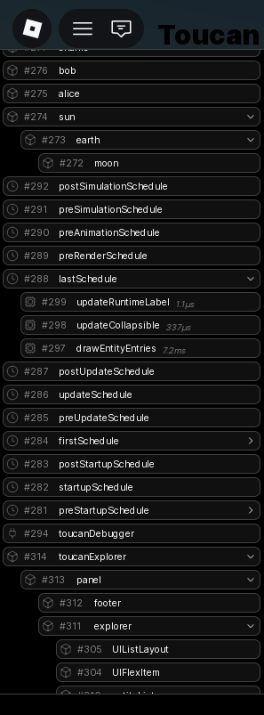

# @rbxts/toucan-debugger

A visual debugger plugin for [Toucan](https://github.com/OverlineJunior/toucan).

Features:

- List every entity along its id and type icon;
- List every component and relationship an entity has;
- Display `ChildOf` hierarchies;
- Measure system runtimes (they're under schedules);
- Observe both the client and the server.



## Installation

```sh
npm install @rbxts/toucan-debugger
```

> [!IMPORTANT]
> The version of Toucan your game uses must be the same as the one this debugger plugin uses. This package currently targets `@rbxts/toucan` `0.7.1`.

## Usage

Pass the plugin to your scheduler before calling `run()`. It must be used on both client and server.

Client:

```ts
import toucanDebuggerClient, { themes } from "@rbxts/toucan-debugger";

// Passing a theme is optional — defaults to dark.
scheduler()
    .usePlugin(toucanDebuggerClient, {
        toggleKeybind: Enum.KeyCode.F4,
        theme: themes.black,
    })
    .run();
```

Server:

```ts
import toucanDebuggerServer from "@rbxts/toucan-debugger";

scheduler().usePlugin(toucanDebuggerServer).run();
```
