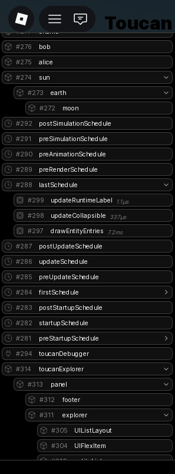

# @rbxts/toucan-debugger

A visual debugger plugin for [Toucan](https://github.com/OverlineJunior/toucan).

It is currently very early in development and cannot observe the server. It can however:

- List every entity-like along its id and type icon;
- Display `ChildOf` hierarchies;
- Measure system runtimes (they're under schedules).



## Installation

```sh
npm install @rbxts/toucan-debugger
```

> [!IMPORTANT]
> The version of Toucan your game uses must be the same as the one this debugger plugin uses. This package currently targets `@rbxts/toucan` `0.6.0`.

## Usage

Pass the plugin to your scheduler before calling `run()`. It must be used on the client.

```ts
import toucanDebugger, { themes } from "@rbxts/toucan-debugger";

// Passing a theme is optional — defaults to black.
scheduler().usePlugin(toucanDebugger, themes.black).run();
```
